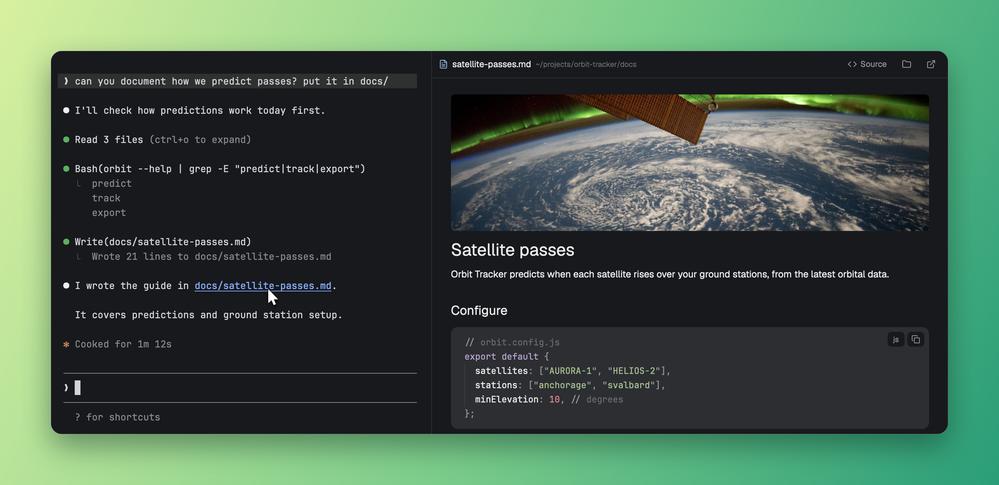

# Markdown Viewer for Herdr

When your coding agent mentions a Markdown file, click the path in the conversation and read it
rendered, right beside the conversation. No switching to another app or hunting for it in Finder.



## What you get

- **Click a path (macOS):** cmd-click a `.md` path in the conversation to open it in a split on the right, or in the viewer already showing. Outside Herdr, `.md` files keep opening in your usual app.
- **Viewer:** rendered Markdown with images and highlighted code blocks with a copy button, reloading as the agent edits the file, with a Source/Preview switch. Links to other `.md` files open in place, with Back. Web links open in your browser.
- **Picker:** a key lists the `.md` paths on the focused terminal's screen, newest first. Enter opens a tab, cmd-Enter (ctrl-Enter on Linux) opens a split. Type to filter, or type a path.
- **Other machines:** the picker and viewer work with terminals on your other Herdr machines too.

## Install

**1. Copy the mod**

```sh
git clone https://github.com/jgrecoarroyo/herdr-markdown.git
cp -R herdr-markdown/mods/* ~/.config/herdr-app/mods/
```

**2. Turn on clicking (macOS)**

This makes a small background app your default for `.md` files. When Herdr is in front, it opens the file in the viewer. Anywhere else, it hands the file to the app you were already using. Building it needs Xcode's command line tools.

```sh
~/.config/herdr-app/mods/markdown-viewer/router/build.sh
~/Applications/Markdown\ Router.app/Contents/MacOS/MarkdownRouter --make-default
```

To undo it, run the same app with `--restore`, which gives `.md` files back to your usual app.

**3. Add a key for the picker**

In `~/.config/herdr-app/keys.json`, inside `"global"`. Use one of these, or any free key:

```json
"cmd-shift-o": "mod.open:markdown-viewer"
```

```json
"ctrl-shift-m": "mod.open:markdown-viewer"
```

## Good to know

- **Platforms:** tested on macOS. On Linux, clicking a path isn't supported yet, so use the picker; it should work but hasn't been tested. Windows isn't supported.
- **Images:** local images show by themselves, as PNG, JPEG, GIF, WebP or SVG up to 20 MB. Web images wait for a click, so opening a file never contacts a server it mentions. Images in files on other machines aren't shown.
- **Code highlighting:** JavaScript, Python, Java, C, C++, C#, Go, Rust, Ruby, PHP, Bash, SQL, YAML, JSON, HTML, CSS and Markdown. TypeScript uses JavaScript's colors. Other languages, such as Swift and TOML, show as plain text with their label.
- **Links:** a link to a non-Markdown file only shows it in its folder and never opens it, because it could point at something that runs.
- **Picker reach:** it reads what the terminal can show. Claude Code exposes only its visible screen, so older paths may not be listed.

## Known issues

- **Code blocks scroll past their last line.** Each block is a small editor, and Herdr has no setting to turn that off.
- **The label and copy button can cover a long line** until you scroll it sideways.
- **Code blocks inside lists keep Herdr's default look**, because drawing them separately would split the list.
- **Images inside a link don't follow it** when clicked, as with most README badges.
- **Reference-style images** (`![alt][ref]`) stay as text.
- **Text can't be selected across an image**, because the text on each side is drawn separately.

## License

[MIT](LICENSE)
