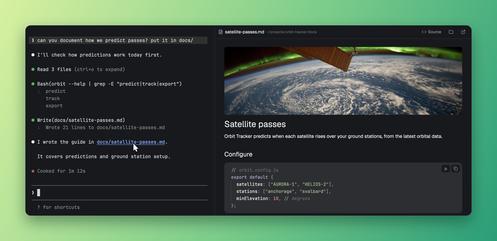

# Markdown Viewer

When a coding agent mentions a Markdown file, cmd-click the path in the conversation and read it rendered, right beside the conversation, instead of switching to another app. On macOS, a background app routes those clicks to the viewer. The viewer reloads the file as it changes and follows links to other Markdown files. A picker lists the `.md` paths on the focused terminal's screen, and is how you open files on Linux.

## What you see

**The picker**, a 620×440 popup at the top of the window, 40 px down, on `popover`:

- A 46 px row with a file icon in `accent` and a text input: "Filter, or type a path…".
- A 330 px scrolling list. Each row is 44 px with radius 7: a file icon, the file name at 13 px semibold, its folder at 11 px `dim` with home shown as `~`, and a split button on the right. The current row is on `selected`.
- A 30 px footer at 11 px `dim`: "↵ new tab", "⌘↵ split beside" ("ctrl ↵" off macOS), "↑↓ choose", "esc close".
- With nothing to list: "No Markdown files in this terminal's recent output. Type a path."

**The viewer**, a tab or a pane on `background`:

- A 40 px header with a `border` line below: Back when there's history, a file icon in `accent`, the file name at 13 px semibold, its folder at 11 px `dim` (prefixed with the machine for a remote file), and 26 px buttons for Source or Preview, show in folder, and open elsewhere. The last two are hidden for remote files.
- Images between the text, at their own size or `width` attribute, never wider than the column, radius 6. Images not shown yet are 30 px `raised` chips with an icon, the alt text and a note.
- The file rendered at 14 px, centered to at most 860 px, with 28/24 px padding. Source shows it in a read-only editor with Markdown highlighting. Front matter isn't shown in the preview.
- Notes: "Loading…", "This file is empty.", "This file isn't there (anymore)."

## How it behaves

- **Agent status:** it shows none; working, blocked, done and idle agents look the same.
- **The picker opens** with the paths in the terminal's last 400 lines, lowest on screen first, keeping only files that exist where the terminal runs. One match opens straight away.
- **Keys in the picker:** Enter opens a tab named after the file, cmd-Enter a split beside the terminal, up and down move, Esc closes, typing filters. If nothing matches, Enter tries the text as a path.
- **Mouse in the picker:** a click opens a tab, a cmd- or ctrl-click or the split button opens a split. Rows change color on hover.
- **Reloading:** local files are watched, with a check every 15 s as a backstop. Remote files are checked every 3 s.
- **Local images** (relative, absolute, `~/`, `file://`) show by themselves, and update if the image changes. A missing or unusable one shows a chip saying why.
- **Web images** stay a chip reading "click to load" until clicked, then download once. Nothing is fetched just because a file was opened. A failed download can be clicked again.
- **Images in remote files** stay a chip naming the machine.
- **Images side by side:** ones with only space between them, such as badges, share a wrapping row.
- **Links:** `.md`, `.markdown` and `.mdx` links open in place, with Back. http, https and mailto links open in the system's handler. Other local files are shown in their folder, never opened.
- **Source or Preview** is remembered per copy of the mod.
- **Open elsewhere:** with the router installed, the app it took over from; otherwise the default app.
- **Cmd-click on macOS, with the router as the default for `.md`:** with Herdr in front, the file goes to the viewer showing in this tab, or a new split on the right. With anything else in front, it goes to the app the router took over from, or TextEdit if none is known.

## Built from

- **`mods/markdown-viewer`:** `main.js` (picker and viewer), `paths.js` (finding paths), `icons.js`, `pictures.js` (finding and loading images), `mod.json`. `props: {file, on?}` makes a viewer; no `file` makes the picker.
- **Opening the picker:** a key bound to `mod.open:markdown-viewer`.
- **Opening a viewer:** `pane.split {direction: "right", pane, mod, props}` or `tab.new {mod, props, name}`.
- **Herdr functions:** `focused`, `panes`, `hc`, `exec`, `run`, `theme`, `settings`, `props`, `closeOverlay`, `home`, `appHome`, `readTextFile`, `watchFolder`, `nextCommand`, `window`, plus `fs/promises` and `localStorage`.
- **Programs:** `hc read`, `sh` where the terminal runs. `open` on macOS, `xdg-open` elsewhere. `cksum`, `cp`, `find` for local images, `curl` for web images.
- **Files written:** copies of images in `data/markdown-viewer/images`, readable only by the user, removed after 30 days untouched.
- **`open.sh` (macOS):** writes `data/markdown-viewer/request.json` and runs `markdown-viewer.show`. A shown viewer takes the file and writes `data/markdown-viewer/ack`. With no answer in about 0.4 s, it runs `pane.split`.
- **`router/` (macOS):** `main.swift` and `build.sh` build `~/Applications/Markdown Router.app`, a background-only default handler for `net.daringfireball.markdown`. `--make-default` saves the current default's bundle id in `data/markdown-viewer/fallback`. `--restore` gives Markdown back to it.

## Watch out

- `TextView` draws no images and ignores `text_color`, so images are cut out of the text and `image()` draws copies from the data folder. Text can't be selected across an image.
- Only files with an image's extension and header are copied, so `` copies nothing. Reference-style images (`![alt][ref]`) aren't handled.
- Herdr draws images only from real folders, so `svg("mods/...")` comes up blank when the mod's folder is a link to a git clone. `icons.js` writes the icons to `data/markdown-viewer/icons` and draws them from there.
- `<mod>.<command>` reaches only shown copies, which is why `open.sh` needs the acknowledgement.
- `window()` can be null, including during `herdr-app check`, so guard it in `render`.
- `EditorState.new` can't run during `render`, and `herdr-app check` won't catch it unless that path draws at load. Create it in the click handler or when the text loads.
- The running Herdr app on macOS may report no bundle id, so `open.sh` matches its path or the name `herdr-app`.
- Claude Code exposes only its visible screen to `hc read`, and its condensed transcript can drop paths.
- With the router as the default, plain `open file` comes straight back to Herdr. Open elsewhere has to name the saved app.
- Tested on macOS only. The Linux paths haven't been run. Windows isn't supported: it uses `sh` and `/` paths.

## Done when

- `herdr-app check` passes for `markdown-viewer`.
- With `.md` paths on the terminal's screen, the key lists them newest first, and only those that exist.
- Enter opens a tab, cmd-Enter a split, and typing a path that exists opens it.
- Editing the open file updates the viewer without a click.
- A link to another `.md` file opens in place, and Back returns.
- Source and Preview switch and stay as chosen.
- With the router: cmd-click on a path opens it in a split, a second opens in that same viewer, and opening a `.md` from Finder goes to the previous default app.
- `--restore` gives `.md` files back to the previous default app.
